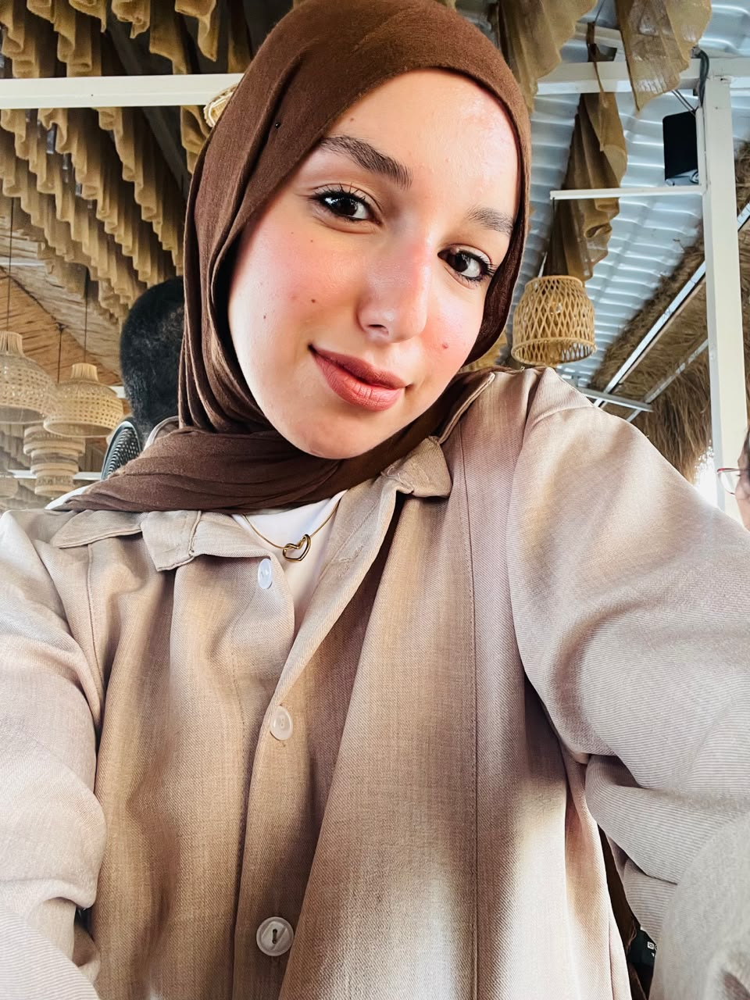

<!DOCTYPE html>
<html lang="ar" dir="rtl">
<head>
<meta charset="UTF-8">
<meta name="viewport" content="width=device-width, initial-scale=1.0">
<title>Rihana Ashraf | Data Analyst</title>
<link href="https://fonts.googleapis.com/css2?family=Cairo:wght@300;400;600;700;900&family=Poppins:wght@300;400;600;700;800&display=swap" rel="stylesheet">

</head>
<body>

<nav>
  
Rihana ✨

  <ul>
    <li><a href="#home">الرئيسية</a></li>
    <li><a href="#skills">المهارات</a></li>
    <li><a href="#projects">المشاريع</a></li>
    <li><a href="#contact">تواصل</a></li>
  </ul>
</nav>

<section class="hero" id="home">
  

    👋 أهلاً بك
    <h1>أنا ريحانة أشرف Data Analyst</h1>
    
محللة بيانات شغوفة بتحويل الأرقام إلى قصص وقرارات ذكية. أحب اكتشاف الأنماط الخفية في البيانات وتحويلها إلى رؤى قيمة تساعد في اتخاذ قرارات أفضل.

    

      <a href="#projects" class="btn btn-primary">شوف شغلي 🚀</a>
      <a href="#contact" class="btn btn-outline">تواصل معايا</a>
    

  

  

   
      
    
📊 Python

    
📈 SQL

    
🎯 Power BI

  

</section>

<section id="skills">
  

    <h2>مهاراتي الاحترافية</h2>
    
الأدوات والتقنيات التي أستخدمها في تحليل البيانات

  

  

    

      
🐍

      <h3>Python</h3>
      
Pandas, NumPy, Matplotlib, Seaborn لتحليل وتصوير البيانات

    

    

      
🗄️

      <h3>SQL</h3>
      
كتابة استعلامات معقدة واستخراج البيانات من قواعد البيانات

    

    

      
📊

      <h3>Power BI & Tableau</h3>
      
إنشاء لوحات تحكم تفاعلية وتقارير احترافية

    

    

      
📗

      <h3>Excel المتقدم</h3>
      
Pivot Tables, Power Query, والمعادلات المتقدمة

    

    

      
📈

      <h3>Statistics</h3>
      
التحليل الإحصائي واختبار الفرضيات وفهم الأنماط

    

    

      
🤖

      <h3>Machine Learning</h3>
      
بناء نماذج تنبؤية باستخدام Scikit-learn

    

  

</section>

<section id="projects">
  

    <h2>أحدث المشاريع</h2>
    
بعض الأعمال التي أفتخر بها في مجال تحليل البيانات

  

  

    

      
🛒

      

        <h3>تحليل مبيعات المتجر</h3>
        
تحليل بيانات مبيعات متجر إلكتروني لاكتشاف المنتجات الأكثر ربحية وسلوك العملاء.

        

          Python
          Pandas
          Power BI
        

      

    

    

      
🎬

      

        <h3>تحليل بيانات الأفلام</h3>
        
استكشاف بيانات IMDb لتحليل العوامل المؤثرة على نجاح الأفلام وتقييماتها.

        

          SQL
          Python
          Matplotlib
        

      

    

    

      
💳

      

        <h3>كشف الاحتيال البنكي</h3>
        
نموذج تعلم آلي لكشف المعاملات المشبوهة بدقة عالية باستخدام تقنيات ML.

        

          Scikit-learn
          Pandas
          ML
        

      

    

  

</section>

<section id="contact">
  

    <h2>خليك على تواصل</h2>
    
عندك مشروع أو فرصة عمل؟ أنا دايماً متاحة!

  

  

    

      <a href="mailto:rihana@example.com" class="contact-link">📧 إيميل</a>
      <a href="https://linkedin.com" target="_blank" class="contact-link">💼 LinkedIn</a>
      <a href="https://github.com" target="_blank" class="contact-link">💻 GitHub</a>
      <a href="https://wa.me/20xxxxxxxxxx" target="_blank" class="contact-link">💬 WhatsApp</a>
    

  

</section>

<footer>
  
© 2025 Rihana Ashraf — صُنع بـ ❤️ وشغف بالبيانات

</footer>

</body>
</html>
